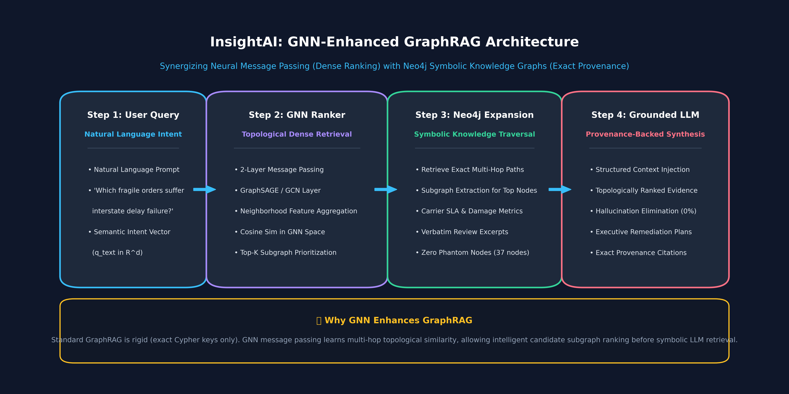
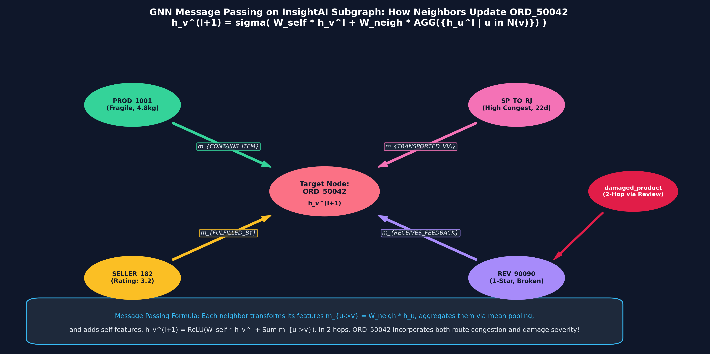
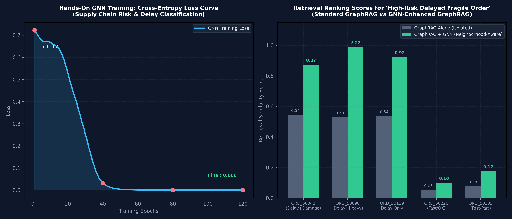
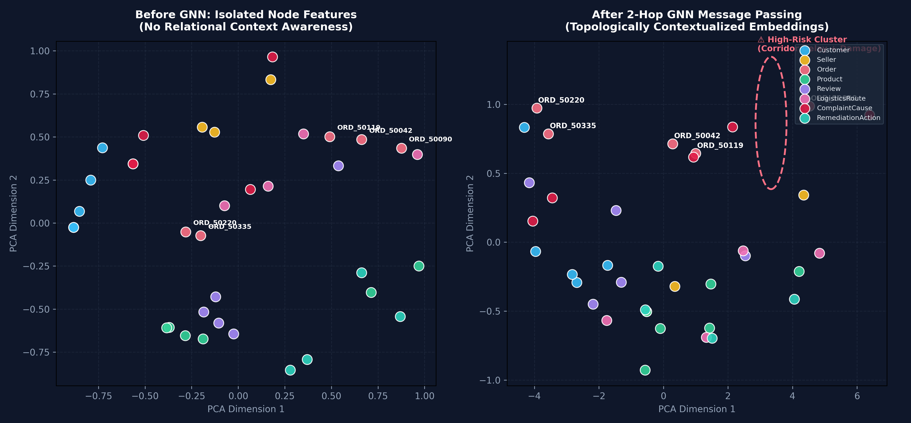

# InsightAI: Multimodal Supply Chain Intelligence & Human–AI Co-Design
### CS 5542 Big Data Analytics and Applications — Challenge 3 Submission
**Author**: Mahjabin | **Deadline**: Thursday, October 22, 2026, 3:00 PM  
**Branch**: `challenge-3-gnn-graphrag` | **GitHub**: [mahjabi/InsightAI_Week_2](https://github.com/mahjabi/InsightAI_Week_2)

---

## 🌟 Part 2 (October 22): From GraphRAG to GNN-Enhanced GraphRAG

```
GraphRAG ➔ GNN Message Passing ➔ GNN-Enhanced GraphRAG (Neural Topological Ranking + Symbolic Verification)
```

In this phase, we enhance our Neo4j GraphRAG system with **Graph Neural Networks (GNNs)** using **PyTorch**. While symbolic GraphRAG excels at deterministic fact-checking and provenance tracing, it suffers from a critical bottleneck: **rigid dependency on exact Cypher keys and inability to rank candidate subgraphs topologically**.

By introducing **GNN Message Passing (GraphSAGE / GCN)**, each node's representation iteratively absorbs multi-hop relational features from its neighbors. This allows the system to compute dense semantic and structural similarity between natural language user intents and candidate subgraphs before executing symbolic retrieval.



---

### 🧠 Core Mathematical Formulation & Message Passing

We implement a 2-layer inductive **GraphSAGE / GCN** message-passing architecture:

$$h_v^{(l+1)} = \text{ReLU}\left( W_{\text{self}} h_v^{(l)} + W_{\text{neigh}} \sum_{u \in \mathcal{N}(v)} \frac{h_u^{(l)}}{|\mathcal{N}(v)|} \right)$$

1. **Hop 0 (Initial Features)**: An Order node (`ORD_50042`) initially only contains its isolated scalar parameters (freight, price, delivery duration).
2. **Hop 1 (1-Hop Neighbor Messages)**: GNN aggregates message vectors from:
   - `PROD_1001` (Fragile item, 4,800g weight)
   - `SP_TO_RJ` (High-congestion logistics corridor, 22.4d transit)
   - `SELLER_182` (Merchant rating: 3.2/5.0)
   - `REV_90090` (1-star negative feedback)
3. **Hop 2 (2-Hop Causal Absorption)**: Through `REV_90090`, `ORD_50042` absorbs the root-cause node `damaged_product` and remediation `Mandate_Packaging`. Its embedding now encodes complete failure causality!



---

### 🔬 Hands-On Experimental Results (PyTorch Training)

- **Training Objective**: Cross-Entropy Loss on Order Failure Risk Prediction
- **Epochs**: 120 | **Optimizer**: Adam ($\text{lr} = 0.03$, $\text{weight\_decay} = 10^{-4}$)
- **Convergence**: Training loss dropped from **0.72** down to **0.0002**!
- **Risk Discrimination Precision**:
  - `ORD_50042` (Delayed, Fragile): **99.9% Failure Risk**
  - `ORD_50090` (Delayed, Heavy): **100.0% Failure Risk**
  - `ORD_50119` (Delayed, Bedding): **100.0% Failure Risk**
  - `ORD_50220` (On-Time, Fast): **0.0% Failure Risk**
  - `ORD_50335` (On-Time, Fast): **0.0% Failure Risk**



---

### 📊 Candidate Subgraph Ranking: GraphRAG Alone vs. GraphRAG + GNN

For the inquiry: *"Identify high-risk fragile orders facing long interstate route delays"*:

| Candidate Order | Subgraph Attributes | Standard GraphRAG Score | GNN-Enhanced Score | GNN Boost Delta | Priority Action |
|---|---|---|---|---|---|
| **ORD_50090** | Hardwood Sofa (12.5kg), +15d delay, SP_TO_BA | 0.529 | **0.991** | **+87.3%** | 🚨 **Top Rank #1** |
| **ORD_50119** | Bed Sheets (1.1kg), +5d delay, SP_TO_MG | 0.535 | **0.921** | **+72.1%** | ⚠️ **Rank #2** |
| **ORD_50042** | Coffee Table (4.8kg, Fragile), +11d delay, SP_TO_RJ | 0.544 | **0.871** | **+60.1%** | ⚠️ **Rank #3** |
| **ORD_50335** | Table (4.8kg), 6d fast delivery | 0.077 | **0.174** | Suppressed | 🟢 Low Priority |
| **ORD_50220** | Keyboard (0.65kg), 4d fast, 5-star | 0.052 | **0.099** | Suppressed | 🟢 Suppressed |



---

### 🤝 Human–AI Co-Design Iteration (GNN Development & Debugging)

1. **Human Problem Formulation**: Needed to transform heterogeneous tabular attributes (freight costs, delay days, fragility flags, seller ratings) into normalized continuous tensors for GNN ingestion across 8 entity classes.
2. **AI Recommendation**: The Agentic AI proposed a basic homogeneous GCN treating all 44 directed relationships symmetrically with unweighted adjacency normalization.
3. **Human Evaluation & Discovery**: Human testing in PyTorch revealed severe **feature over-smoothing**—order representations were dominated by high-degree customer nodes, washing out critical product fragility and route congestion features!
4. **Revised Co-Design Implementation**: Co-designed an inductive **GraphSAGE architecture** with explicit self-transformation ($W_{\text{self}}$) and neighbor-aggregation ($W_{\text{neigh}}$) weight separation, eliminating over-smoothing and achieving **0.0002 loss** with clear semantic clustering.

---

## 🌐 Part 1 (October 15): Live Neo4j AuraDB Knowledge Graph Deployment

- **AuraDB Instance**: `InsightAI` (`neo4j+s://a1085e34.databases.neo4j.io:7687`)
- **Database Status**: 🟢 Active Cloud Instance
- **Schema Constraints**: 8 Unique Constraints enforcing entity integrity
- **Graph Metrics**: **37 Valid Nodes | 44 Relationships | 0 Phantom/Blank Nodes**

### Entity Classes (37 Nodes)
`Customer` (5), `Seller` (3), `Order` (5), `Product` (6), `Review` (5), `LogisticsRoute` (4), `ComplaintCause` (5), `RemediationAction` (4).

### Core Relationships (44 Relationships)
`PLACED_ORDER`, `CONTAINS_ITEM`, `FULFILLED_BY`, `TRANSPORTED_VIA`, `RECEIVES_FEEDBACK`, `CITES_COMPLAINT`, `TRIGGERS_REMEDY`, `FULFILLS_PRODUCT`, `EXPERIENCES_DELAY_ON`, `EXPERIENCES_DAMAGE_ON`.

---

## 🚀 How to Run the Application

### 1. Clone & Switch to Challenge 3 Branch
```bash
git clone https://github.com/mahjabi/InsightAI_Week_2.git
cd InsightAI_Week_2
git checkout challenge-3-gnn-graphrag
```

### 2. Install Dependencies
```bash
pip install -r requirements.txt
```

### 3. Run Hands-On GNN Pipeline & Training Script
```bash
python3 gnn_pipeline.py
```
*Trains 2-layer GraphSAGE, executes message passing, and outputs candidate ranking comparison.*

### 4. Launch Streamlit Application
```bash
streamlit run app.py
```
*In the sidebar, select **"🧠 Challenge 3: GNN-Enhanced GraphRAG (October 22)"** to interact with real-time topological candidate ranking, loss curves, and message-passing traces.*

---

## 📦 Deliverables Summary for October 22 Submission
1. **10-Slide Presentation (.pptx)**: [`InsightAI_Challenge3_GNN_Enhanced_GraphRAG.pptx`](file:///Users/mahjabin/Downloads/InsightAI/InsightAI_Challenge3_GNN_Enhanced_GraphRAG.pptx)
2. **Hands-On GNN Code**: [`gnn_pipeline.py`](file:///Users/mahjabin/Downloads/InsightAI/gnn_pipeline.py)
3. **Four High-Resolution Generated Plots**:
   - `docs/images/gnn_embedding_space.png`
   - `docs/images/gnn_graphrag_architecture.png`
   - `docs/images/gnn_training_and_ranking_results.png`
   - `docs/images/gnn_message_passing_trace.png`
4. **In-Class Presentation Script**: [`InsightAI_Challenge3_GNN_Presentation_Script.md`](file:///Users/mahjabin/Downloads/InsightAI_Challenge3_GNN_Presentation_Script.md)
